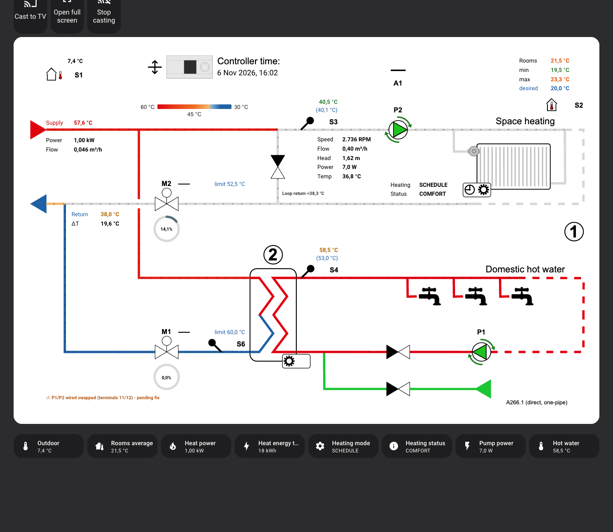
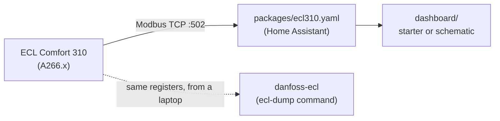

# Danfoss ECL Comfort 310 for Home Assistant

**Read your Danfoss ECL Comfort 310 district-heating controller in Home Assistant. It's one YAML file, and needs no
custom integration.**


<sub>The optional schematic dashboard from [`dashboard/`](dashboard/). Drawing © Danfoss; values live from the
author's ECL 310.</sub>

The package talks to the controller over **Modbus TCP**, using Home Assistant's built-in
[`modbus`](https://www.home-assistant.io/integrations/modbus/) integration. You get temperatures, setpoints, pumps,
valves, modes and alarms as normal sensors, ready for history, automations and dashboards. It only **reads**: it
never changes a setting on the controller.

Built and tested on one ECL Comfort 310 running application **A266.1**, with Home Assistant 2026.11.

## Quick start

You need an ECL Comfort 310 with application A266.x that is on your network (see [Requirements](#requirements)).

1. **Enable packages.** Add this to `/config/configuration.yaml` once, if it isn't there already:

   ```yaml
   homeassistant:
     packages: !include_dir_named packages
   ```

2. **Add the package.** Create the folder `/config/packages/` and copy [`packages/ecl310.yaml`](packages/ecl310.yaml)
   into it. You can use the *File editor*, *Samba share* or *Terminal & SSH* add-on, or any way you normally edit
   `/config`.

3. **Point it at your controller.** In `ecl310.yaml`, change `host: 192.168.1.100` to your controller's IP address.

4. **Check and restart.** Developer tools → YAML → **Check configuration**, then **Restart**.

5. **See it work.** Settings → Devices & services → Entities, and search for `ECL`.
   `binary_sensor.ecl_modbus_online` should be **on**, and `sensor.s1_outdoor_temperature_sensor` should show your
   outdoor temperature.

Nothing there? See [Troubleshooting](#troubleshooting).

## Requirements

| What | Details |
|---|---|
| Controller | Danfoss **ECL Comfort 310** running application **A266.x** (space heating + domestic hot water). Other applications (A247, A260, …) use other registers |
| Network | The controller's Ethernet port on your LAN, with a **fixed IP address**. Set or read it on the controller under *Common controller settings → System → Ethernet*, or find it in your router's list of DHCP clients |
| Modbus TCP | Built into the ECL Comfort 296, 310 and 310B. Home Assistant must reach the controller on TCP port **502** |
| Home Assistant | A recent version with YAML packages enabled (tested with 2026.11) |

**Not sure about your application, or whether Modbus works?** The companion tool
[danfoss-ecl](https://github.com/muddermanden/danfoss-ecl) reads the controller from a laptop and prints the
application (for example `A266.1`) and every value. If it works there, it will work in Home Assistant.

### Words you'll meet

| Term | Meaning |
|---|---|
| **A266.x** | The ECL *application*: the program the controller runs. A266 is space heating plus domestic hot water (DHW), in four subtypes: A266.1, .2, .9 and .10 |
| **Circuit 1 / 2** | In A266, circuit 1 is space heating and circuit 2 is domestic hot water |
| **S1–S6** | Temperature sensors: S1 outdoor, S3 heating flow, S4 DHW flow, and the optional S2 room, S5 heating return and S6 DHW return |
| **M1 / M2** | Motorised control valves (M2 heating, M1 hot water), driven open or closed in pulses |
| **V1 / V2** | 0–10 V control of the same valves, shown as a percentage. An alternative to the 3-point M1/M2 |
| **P1 / P2** | Circulation pump relays |
| **A1** | Alarm relay |
| **Parameter ID** | The number Danfoss gives each value and setting (*ID no.* in the Operating Guide, for example `11177`; the second digit is the circuit). This project calls it the PNU. The Modbus address is ID − 1 (verified on the author's controller; the guide doesn't cover Modbus addressing) |

## What you get

[`packages/ecl310.yaml`](packages/ecl310.yaml) creates these entities. All of them are **read-only**.

| Group | Entities |
|---|---|
| Temperatures | S1 outdoor, S2 room, S3 heating flow, S4 DHW flow, S5/S6 return |
| Setpoints | Desired room / flow / return (circuit 1), desired DHW flow / return (circuit 2), comfort and setback temperature |
| Outputs | M1/M2 valve opening/closing, P1/P2 pump relays, A1 alarm relay, V1/V2 valve position (%), triacs 5/6 |
| Overrides | Override state of M1/M2/P1/P2/A1/V1/V2 (`AUTO` or manual), plus a *Manual Override* problem sensor for each |
| Mode and status | Mode and status of heating circuit 1 and DHW circuit 2 |
| Diagnostics | `ECL Modbus Online`, `ECL Alarm`, controller clock, firmware version, application (for example `A266.1`) |
| Derived | Heating and DHW flow deviation (actual − desired) |

Entity ids follow the names, for example `sensor.s3_flow_temperature_sensor_circuit_1` or
`sensor.mode_heating_circuit_1`. Sensors ending in `_raw` hold the plain register values; template sensors turn
them into readable states such as `OPENING`, `AUTO` or `COMFORT`. Keep the `_raw` sensors, because the readable
ones are built from them. You can hide them in the UI.

A temperature sensor that isn't connected (S2, S5 and S6 are optional) shows `- -` on the controller's display and
reads **192 °C** over Modbus (observed; the guide only describes the display). Disable that entity in the UI.

## Optional extras

[`packages/ecl310_extras.yaml`](packages/ecl310_extras.yaml) adds three sensors that combine the ECL with hardware
that is **not** part of the controller. Install it only if you have equivalents, and change the entity ids in the
file to your own.

| Sensor | Needs |
|---|---|
| Heat Meter Faults | A district-heating meter's fault flags |
| Return Limit Deviation | The heat meter's return temperature |
| Radiator Loop Return Estimated | The heat meter's supply/return temperature and flow, plus the circulation pump's flow |

The author reads a heat meter over wireless M-Bus with the
[wmbusmeters add-on](https://github.com/wmbusmeters/wmbusmeters-ha-addon) (entities `sensor.varme_c5_*`), and a
Grundfos ALPHA2 GO pump through an ESP32 with ESPHome (`sensor.heating_pump_flow`).

## Dashboard

[`dashboard/`](dashboard/) has two ways to show it all:

- **Starter dashboard:** a ready-made YAML file with tiles, history and a simple schematic. Paste it in and you're
  done.
- **Schematic dashboard:** the one in the screenshot. It is generated from your own copy of the Danfoss drawing
  and a small config file, and adapts to the hardware you have.

## How it fits together



This repository is one of two:

| Repository | What it is | Use it when |
|---|---|---|
| **homeassistant-danfoss-ecl310** (this one) | Home Assistant YAML package and dashboards | You want the ECL in Home Assistant |
| [danfoss-ecl](https://github.com/muddermanden/danfoss-ecl) | Python register catalog and `ecl-dump` command | You want to check a controller, document its settings or look up a register |

The package's register addresses, scales and decoding come from the danfoss-ecl catalog. The two are
**independent**: they share no code, and neither needs the other to run.

## Troubleshooting

**All ECL entities are `unavailable`.**
Home Assistant can't reach the controller. Check the IP in `ecl310.yaml`, that the controller answers a ping, and
that nothing blocks TCP port 502 between Home Assistant and the controller (a firewall or a separate VLAN, for
example). Settings → System → Logs, filtered on `modbus`, shows the exact error.

**The IP is right, but every read fails.**
Check the controller's Modbus address under *Common controller settings → System → Communication → Modbus addr.*
(ID 38, factory setting 1). If it isn't 1, add `slave: <that address>` to each sensor in `ecl310.yaml`. `ecl-dump`
from [danfoss-ecl](https://github.com/muddermanden/danfoss-ecl) with `ECL310_UNIT_ID=<address>` is a quick way to
test.

**A temperature shows 192 °C.**
That sensor isn't connected. The controller's display shows `- -` for it, and Modbus returns 192 °C (observed on
the author's controller). Disable the entity. A short-circuited sensor shows `- - -` on the display; its Modbus
value hasn't been verified.

**Values look wrong, or are off by a factor of 10 or 100.**
Your controller may run another application or firmware version. Compare with the controller display or Leanheat,
and look the register up in the danfoss-ecl catalog or the Operating Guide (see [Sources](#sources)).

**Check configuration complains about `homeassistant:`.**
`configuration.yaml` already has a `homeassistant:` section. Put the `packages:` line inside it instead of adding a
second one.

## Sources

- Danfoss **Operating Guide ECL Comfort 210 / 296 / 310, application A266**, document AQ156586461753en-010601
  (2021.06). Download it from danfoss.com → Service and support → Downloads. It explains every value and setting:
  sensors and outputs (section 2.1), the Ethernet and Modbus settings (6.8.3 and 6.8.10), and in appendix 7.8
  *Parameter ID overview* each parameter's ID, setting range and factory value.
- Observed on the author's ECL Comfort 310 (A266.1, software 2.45) with
  [danfoss-ecl](https://github.com/muddermanden/danfoss-ecl): the Modbus address = ID − 1, the scale factors, and
  192 °C for an unconnected sensor. The guide doesn't describe Modbus values.

**Another ECL model or application?** For example an ECL Comfort 110/120, or another application key such as
A247: Danfoss publishes an Operating Guide for each, with its own *Parameter ID overview*. Find your parameter IDs
there, check what your controller really returns with an `ecl-dump`-style read, and only then use ID − 1 as the
`address:` in a copy of `ecl310.yaml`. The guide also tells you whether your controller has Modbus over Ethernet.
The A266 guide is not included here, because it is Danfoss's copyright.

## Disclaimer

Not affiliated with or endorsed by Danfoss. Danfoss, ECL Comfort and Leanheat are trademarks of their owners.
Tested on one ECL Comfort 310 with A266.1. The package only reads from the controller. Check its values against
the controller display or Leanheat before you rely on them.

## License

MIT, see [LICENSE](LICENSE).
