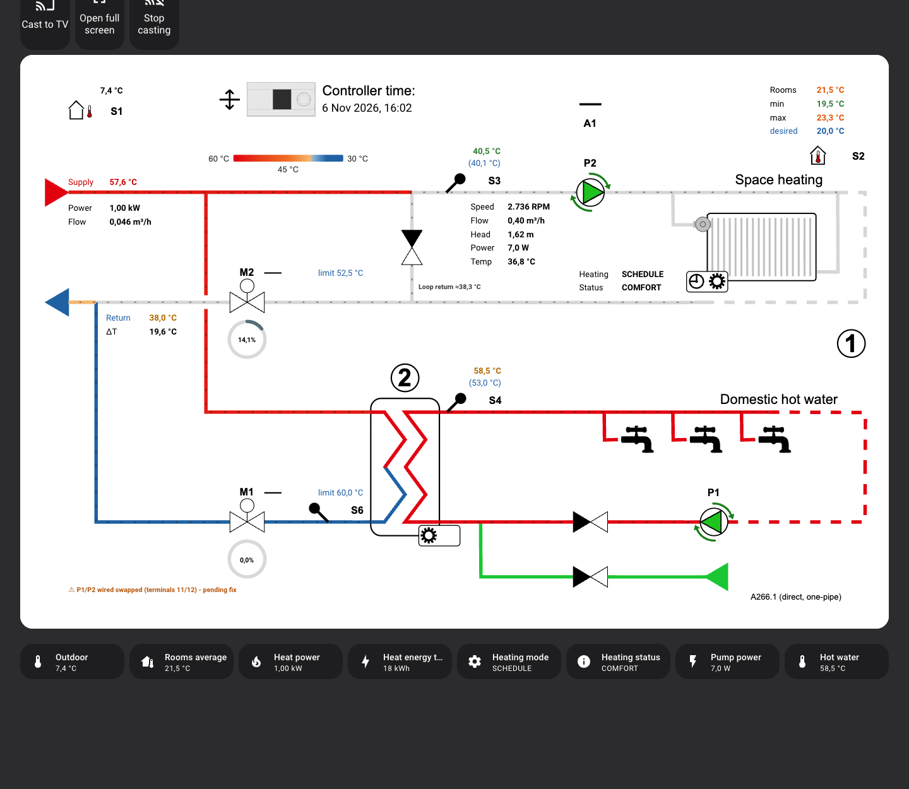
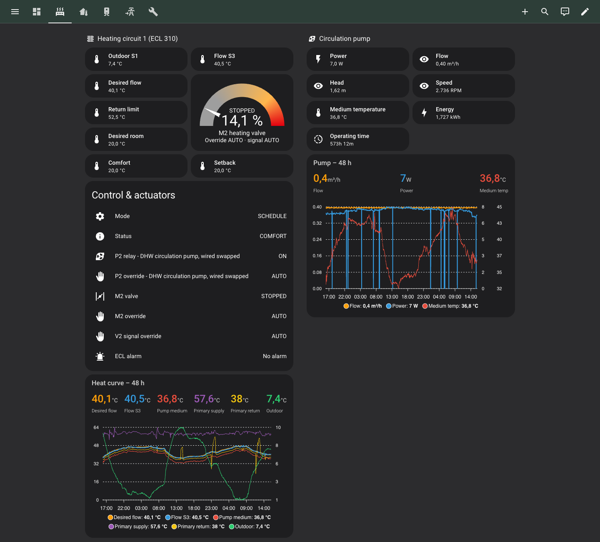
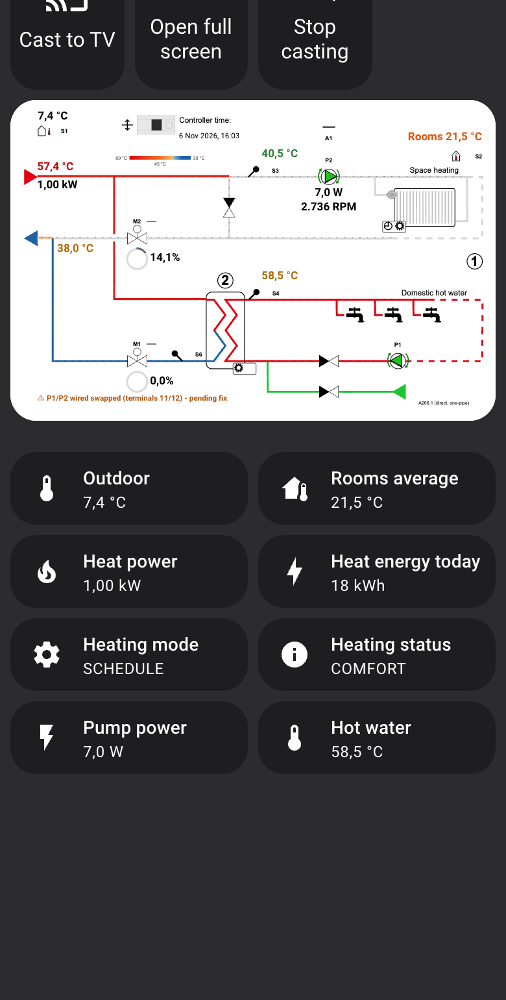
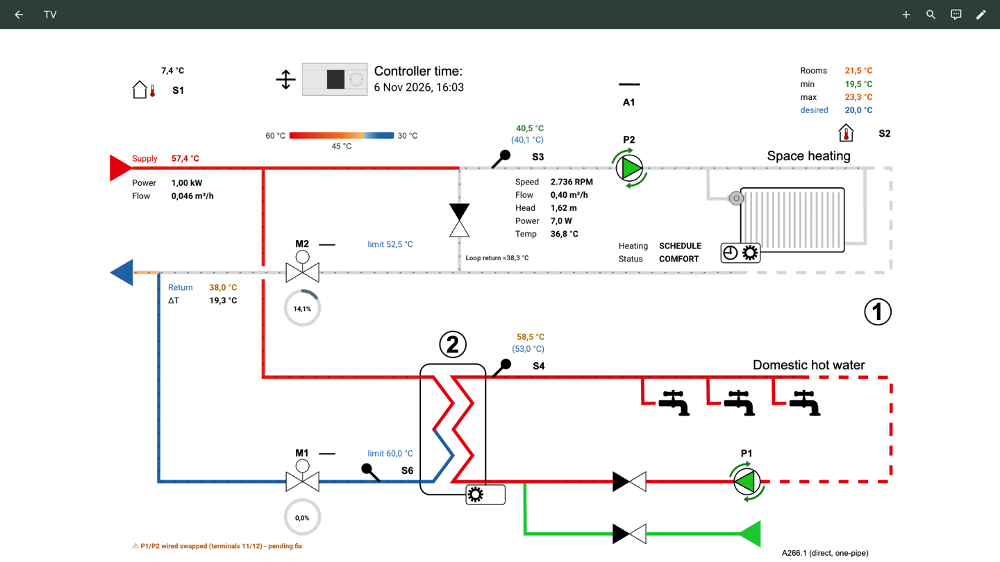

# Heating dashboard

**The schematic dashboard is generated, not shipped as a file.** Prepare your copy of the Danfoss drawing with
[`generator/clean_drawing.py`](generator/clean_drawing.py). Then [`generator/build.py`](generator/build.py) reads
it with your `config.local.yaml` and writes `build/heating-dashboard.yaml`, which you paste into Home Assistant. The author's own dashboard is built the same way: their `config.local.yaml` (not in the
repo) reproduces it exactly. A finished dashboard file isn't committed for two reasons. Its pump, valve and pipe
overlays are pieces of the Danfoss drawing (copyright), and it is full of one house's entity ids.

## What to expect

Screenshots of the author's generated dashboard. Drawing © Danfoss; values live from the author's ECL 310.



| Space heating view | Phone | TV view |
|---|---|---|
|  |  |  |

The author's setup has every option on (heat meter, circulation pump, rooms, direct-heating variant). With
`config.example.yaml` you get the same schematic without those values, on the original Danfoss drawing.

Two ways to get the ECL 310 into a dashboard:

| | What | Needs |
|---|---|---|
| **Starter** | [`starter-dashboard.yaml`](starter-dashboard.yaml): tiles, history and a simple schematic. A ready-made file | Only [`packages/ecl310.yaml`](../packages/ecl310.yaml), core cards |
| **Schematic dashboard** | Generated by [`generator/`](generator/): the Danfoss A266 diagram with live values, coloured pipes, animated pumps, warnings, trend charts, views for heating, hot water, rooms, district heating and diagnostics, plus a TV view | Your own copy of the Danfoss drawing, [`packages/heating_rooms.yaml`](../packages/heating_rooms.yaml), Python 3.10+, three HACS cards |

Everything house-specific lives in the config file, so you can adapt the generator without changing its code.

## Starter dashboard

1. Install [`packages/ecl310.yaml`](../packages/ecl310.yaml) and check that the entities have values.
2. Settings → Dashboards → **Add dashboard** → *New dashboard from scratch*.
3. Open it, then ⋮ → **Edit dashboard** → ⋮ → **Raw configuration editor**, paste `starter-dashboard.yaml`, save.
4. The first card shows your copy of the Danfoss drawing, saved as `/config/www/ecl310/a266.svg` (see *Get the drawing*). Delete that
   card if you don't want it.

## Schematic dashboard

### 1. Get the drawing

**The Danfoss drawing isn't in this repository.** It is Danfoss material and their copyright, so it isn't
redistributed here. You can save your own copy from the Danfoss **Leanheat Monitor** web app, which shows the
same diagram for your controller:

1. Open Leanheat Monitor in a desktop browser and go to your ECL 310's schematic (system diagram) view.
2. Press **F12** to open the developer tools and select the **Network** tab.
3. Reload the page (Cmd/Ctrl + R) so the requests are recorded.
4. Type `svg` in the filter box (and `drawio` for the editable source). Click the request with the diagram,
   e.g. `A266_1...svg`, and save the response (right-click → *Open in new tab* → save, or copy the response).
5. Save it in `dashboard/drawings/`, e.g. as `A266.1a.svg`. The `drawings/` folder is git-ignored, so it never
   gets committed.
6. Clean it: this removes the empty value fields (`--,-- °C`, `1st Jan 1970`) that Home Assistant replaces with
   live values, and names the two circuits (`circuit_titles` in the config):

   ```bash
   python3 generator/clean_drawing.py drawings/A266.1a.svg drawings/a266.svg --config config.local.yaml
   ```

   It should report `placeholders left: 0`.

Use the drawing for yourself and respect Danfoss's terms. Don't publish it.

The generator expects the 1205 × 756 px **A266.1 "ex. a"** drawing. Other A266 subtypes or drawing versions
have other positions: the overlays and labels then need adjusting (see *Adapting to another drawing*).

### 2. Install the packages

- [`packages/ecl310.yaml`](../packages/ecl310.yaml): required
- [`packages/heating_rooms.yaml`](../packages/heating_rooms.yaml): required. It is a package (template sensors),
  not the dashboard: the "Heating Dashboard Text" helper the schematic uses for static text, and room statistics
  for `features.rooms` (rooms labelled "Heated room"). Copy it to `/config/packages/`.
- [`packages/ecl310_extras.yaml`](../packages/ecl310_extras.yaml): only with a heat meter and pump flow

HACS frontend cards used by the views: [apexcharts-card](https://github.com/RomRider/apexcharts-card),
[gauge-card-pro](https://github.com/benjamin-dcs/gauge-card-pro) and, with `features.rooms`,
[config-template-card](https://github.com/iantrich/config-template-card).

### 3. Configure

```bash
cd dashboard
cp config.example.yaml config.local.yaml
```

`config.local.yaml` is git-ignored. The main settings:

| Setting | Meaning |
|---|---|
| `drawing` | Path to your Danfoss SVG |
| `features.heat_meter` / `circulation_pump` / `rooms` | Optional hardware. Off: every card, value and colour rule that needs it is left out |
| `variant.direct_heating` | Redraw circuit 1 as direct heating with a mixing loop (the author's house). Off: the original drawing |
| `tv.view`, `tv.media_player` | Full-screen TV view, and "Cast to TV" buttons |
| `weather`, `network_tracker`, `other_rooms` | Optional extras for the overview, diagnostics and rooms views |
| `entities.exact`, `entities.prefixes` | Map the generator's generic entity ids to yours |

The generator uses the package's entity ids for the ECL, and generic ids for the optional hardware:
`sensor.heat_meter_*` for the heat meter and `sensor.circulation_pump_*` for the pump. If yours differ, map them:

```yaml
entities:
  exact:
    binary_sensor.heat_meter_flowing: binary_sensor.my_meter_flowing
  prefixes:
    sensor.heat_meter_: sensor.my_meter_         # sensor.heat_meter_power -> sensor.my_meter_power
    sensor.circulation_pump_: sensor.grundfos_
```

### 4. Build

```bash
python3 -m venv .venv && .venv/bin/pip install -r generator/requirements.txt
.venv/bin/python generator/build.py --config config.local.yaml
```

This writes to `build/` (git-ignored):

- `heating-dashboard.yaml` (and `.json`): the dashboard
- `a266-schematic.svg`, `a266-schematic-tv.svg`: the background drawings

Optional: `--states states.json` checks that every entity exists. The file is a JSON object with `states` (the
`/api/states` list) and, if you have it, `entities` (the entity registry).

### 5. Load it into Home Assistant

1. Copy both SVGs to `/config/www/heating/` (served as `/local/heating/`).
2. Settings → Dashboards → **Add dashboard** with the URL from `dashboard_path` (default `dashboard-heating`).
3. ⋮ → **Edit dashboard** → ⋮ → **Raw configuration editor**, paste `build/heating-dashboard.yaml`, save.

After changing the config or the drawing, build again and repeat steps 1 and 3.

## How the schematic dashboard works

Everything is core Home Assistant cards except the charts and gauges:

1. A **`picture-elements` card** uses the drawing as its background.
2. **`state-label` elements** sit on each sensor symbol, positioned with `left`/`top` in percent so the card scales.
   Font sizes use CSS `clamp(…, vw, …)`, so text stays readable from phone to TV. Phones get their own, sparser
   label set.
3. **Conditional layers.** The generator cuts each live symbol (pumps, valves, pipes, alarm bell) out of the
   drawing as a small SVG and adds one `conditional` overlay per state and colour: a pump running, a valve
   opening or closing, a pipe at a given temperature. That gives several hundred overlays, which is why the
   dashboard is generated rather than written by hand.
4. **Animation.** Pump arrows turn slowly (8 s per turn) while the relay is ON, and dashes move along a pipe
   while there is flow. Motion is kept slow on purpose.
5. **Stale and offline values turn grey** while the value is `unavailable`/`unknown`, or while its source is
   offline (`binary_sensor.ecl_modbus_online` for ECL values, the pump's link sensor for pump values).
6. **Navigation.** The circled 1 and 2 on the drawing open the Space heating and Hot water views.

Code map (`generator/`):

| File | Does |
|---|---|
| `build.py` | Reads the config, builds the views and writes the output |
| `schematic.py` | Label positions (`LABELS`, `STACKS`, `PHONE_LABELS`), colour rules, the picture-elements card |
| `live_symbols.py` | Cuts the live symbols out of the drawing, overlays, pump arrows, flow dashes |
| `direct_heating.py` | The direct-heating / one-pipe redraw of circuit 1 (`variant.direct_heating`) |
| `colour_scale.py` | Pipe colours by temperature |
| `settings.py`, `prune.py` | Config loading, entity mapping, leaving out disabled features |

### Colour rules

| Cue | Driven by | Rule |
|---|---|---|
| Heating flow value S3 | `sensor.heating_flow_deviation` (S3 − desired) | green within ±2 K, amber otherwise |
| DHW flow value S4 | `sensor.dhw_flow_deviation` (S4 − desired) | green within ±2 K, amber otherwise |
| Valve ring M1 / M2 | valve motor state | red OPENING, blue CLOSING, grey otherwise; fill = valve % |
| Pump arrows P1 / P2 | relay registers 4006 / 4007 | turning while ON, grey and still otherwise |
| Amber pulse | alarm and override registers | shown only while active |
| Pipe colour | the pipe's own temperature sensor | fixed scale: 30 °C blue → 45 °C orange → 60 °C red |
| Stale value | value unavailable, or source offline | grey `#9e9e9e` |
| Summer cut-out label | S1 outdoor | shown above `heat_cut_out_c` |
| District return *(heat meter)* | return temperature | green < 35 °C, amber 35–45 °C, red > 45 °C; red whenever above the ECL return limit |
| ΔT *(heat meter)* | supply − return | green ≥ 25 K, amber < 15 K |
| Rooms avg/min/max *(rooms)* | value − desired room | green within ±1 K, blue colder, orange warmer |

### Adapting to another drawing

All positions are in the drawing's own pixel coordinates (1205 × 756 for A266.1):

- Value labels: `LABELS`, `STACKS` and `PHONE_LABELS` in `schematic.py`
- Pipes and flow paths: `PIPES` and `FLOWS` in `live_symbols.py` (SVG path data along the pipes)
- Pump centres: `PUMP_CENTRES` in `live_symbols.py`; alarm/override pulses: `PULSES`

Open your SVG in a browser or Inkscape to read off coordinates. Then build and check the result.

## Limits

- Tested with one installation: ECL 310, A266.1, Leanheat drawing "A266_1 ex. a", Home Assistant 2026.
- The overview text only appears with `heat_meter` and `circulation_pump` enabled, because it describes that flow.
- The Danfoss drawing and ECL Comfort are Danfoss material. This project is not affiliated with Danfoss.
